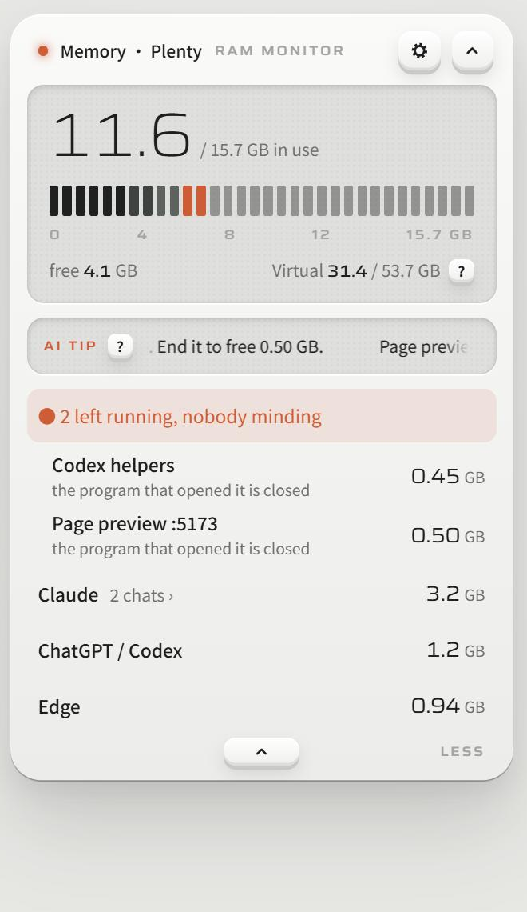
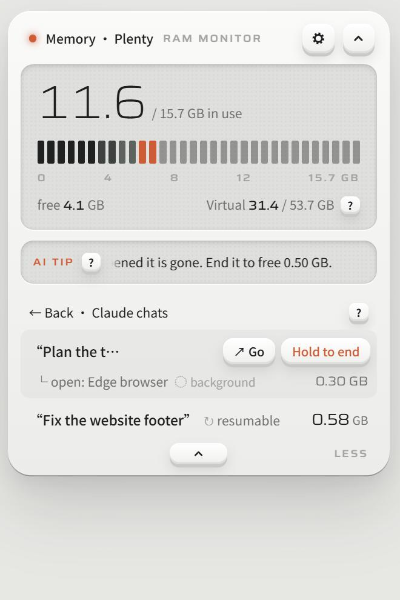

# RAMiao 内存喵

**A tiny memory widget for Windows that knows which AI chat opened what.**
Claude Code, Codex, Gemini CLI and friends open browsers, page previews and helper programs as they work, and many of those keep running after the chat stops. RAMiao sits at the top of your screen, groups every program under the AI chat that opened it, points out the ones nobody is minding, and lets you end them with a press-and-hold.

[中文说明](README.zh-CN.md) · [Download for Windows](https://github.com/Miaomiaomeowmeow/ramiao/releases/latest)

> **The author is looking for a job!** If you have an opportunity, see [my website](https://miaomiaoyang.com) or reach out on [LinkedIn](https://www.linkedin.com/in/miaomiao-yang-331901383) · Xiaohongshu (RedNote) @羊猫猫不是猫 · [more](#contact)

| Resting on your screen | Click it: what is using memory | Open an AI app: one row per chat |
|---|---|---|
|  |  |  |

*Screenshots use made-up sample data.*

## What it does

- **Sorted the way you think, by chat.** Your AI app (Claude, Codex…) is one row; click it and every chat is listed by the name you gave it in the app, with the browser, page preview or Blender it opened right under it.
- **Knows who opened what, even after the chat stopped.** AI tools leave a small marker on everything they start. RAMiao reads only those marker names, so a page preview from a chat you closed yesterday still says *“opened by ‘Fix the website footer’, that chat has stopped”*.
- **Nobody minding?** Leftovers (page previews with no owner, helpers that were never closed) are listed on top in orange. Hover a row, press and hold **Hold to end**.
- **↗ Go** jumps to the chat in the Claude app or the Codex app, brings a window to the front, or opens a page preview in your browser.
- **Symbols instead of labels:** ↻ the chat can continue after you end it · ⊘ only what it opened can be closed here · ◌ runs in the background, no window. For your first five opens the words are shown next to them; the **?** explains them, along with what ending each kind of thing does.
- **Watchdog.** If free memory really runs out (under 1 GB), it stops the fastest-growing thing *an AI* opened so your computer does not freeze. Programs you opened yourself are never stopped. You can switch it to *Warn only*.
- **Ask an AI (optional).** Borrow the Codex or Claude Code you are already signed in to (no key needed), or use your own API key (Claude or any OpenAI-compatible provider). It only sends program names and sizes, and only when you tap **Ask AI**. The AI only suggests; RAMiao does the ending, and only after you hold to accept.
- English / 中文, a light and a graphite look, short or long resting size.

## Install

1. Download `RAMiao_x.y.z_x64-setup.exe` from [Releases](https://github.com/Miaomiaomeowmeow/ramiao/releases/latest) and run it.
2. Windows may say *“Windows protected your PC”* because the installer is not code-signed (signing costs money). Click **More info → Run anyway**.
3. A small box with a percentage appears at the top of your screen. Drag it anywhere. `Ctrl + Shift + M` opens or closes the panel; the tray icon hides it or quits.

Windows 10 / 11, 64-bit. macOS and Linux are not supported yet.

## Which AI tools it recognizes

Built in: **Claude Code** (the Claude app and the terminal), **Codex** (the Codex app and the CLI), Gemini CLI, Cursor, OpenCode, Copilot CLI, Augment, Antigravity, aider. Any new tool that follows the common `AI_AGENT=<tool>` convention is picked up by name automatically.

### Add one yourself

Everything about a tool lives in one line of [`src-tauri/agents.json`](src-tauri/agents.json). Put a file with the same format at `%APPDATA%\com.miaomiao.ramiao\agents.json` and restart; a line with the same `id` replaces the built-in one.

| Field | What it says |
|---|---|
| `id`, `name` | Short id and the name shown in the list |
| `env` / `aiAgent` | Marker variable names the tool puts on programs it starts (only the names are checked) |
| `conv` / `host` / `app` | How to recognize one chat's process, a shared background process, and the desktop app (`exe`, `path`, `args`, `notArgs`) |
| `appName`, `appNameEn` | What to call the app in the list |
| `nameEnv` / `threadEnv` + `nameIndex` | Where the chat's name comes from |
| `sessionEnv` + `titleDir` + `titleFile` + `titleKey` | Find the chat's name from its saved history, even after it stopped |
| `linkEnv` + `link` | The link that opens one chat, e.g. `codex://threads/{id}` |
| `endNote` / `cliNote` (+`En`) | What to tell people before they end a chat (in the app / in a terminal). Leave empty when unsure |

## Privacy

- RAMiao reads **only the variable names listed in `agents.json`** from other programs; nothing else from their environment.
- Nothing leaves your computer unless you choose an AI and tap **Ask AI**. Then it sends program names and memory sizes, not files and not window titles.
- An API key is stored only inside RAMiao on this computer and goes only to the provider you chose.

## Build from source

You need [Node.js](https://nodejs.org), [Rust](https://rustup.rs) and the Tauri 2 prerequisites for Windows.

```bash
npm install
npx tauri build
```

The installer ends up in `src-tauri/target/release/bundle/nsis/`. A step-by-step guide in Chinese is in [`docs/GUIDE.zh.md`](docs/GUIDE.zh.md).

## Not done yet

- macOS and Linux builds (the window jumping behind **↗ Go** is Windows-only today).
- The installer is not code-signed.

## License

[CC BY-NC-SA 4.0](LICENSE): you can use and change it; if you share a changed version, credit the author and share it under the same license; no commercial use. If you build something on it, I would love to hear about it.

## Contact

Made by **Miaomiao** ([GitHub @Miaomiaomeowmeow](https://github.com/Miaomiaomeowmeow)).
Website: [miaomiaoyang.com](https://miaomiaoyang.com) · [LinkedIn](https://www.linkedin.com/in/miaomiao-yang-331901383) · Xiaohongshu (RedNote) @羊猫猫不是猫
