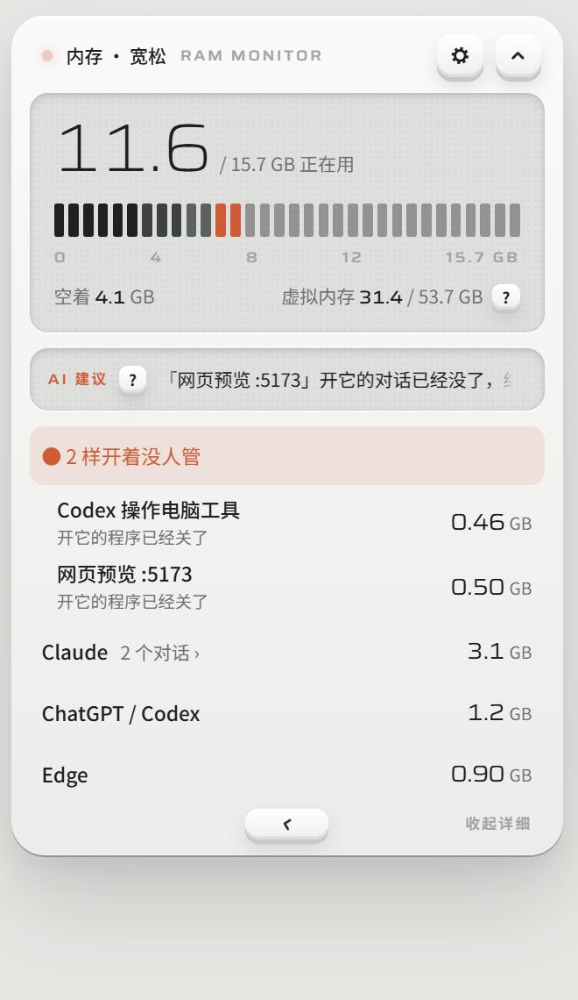
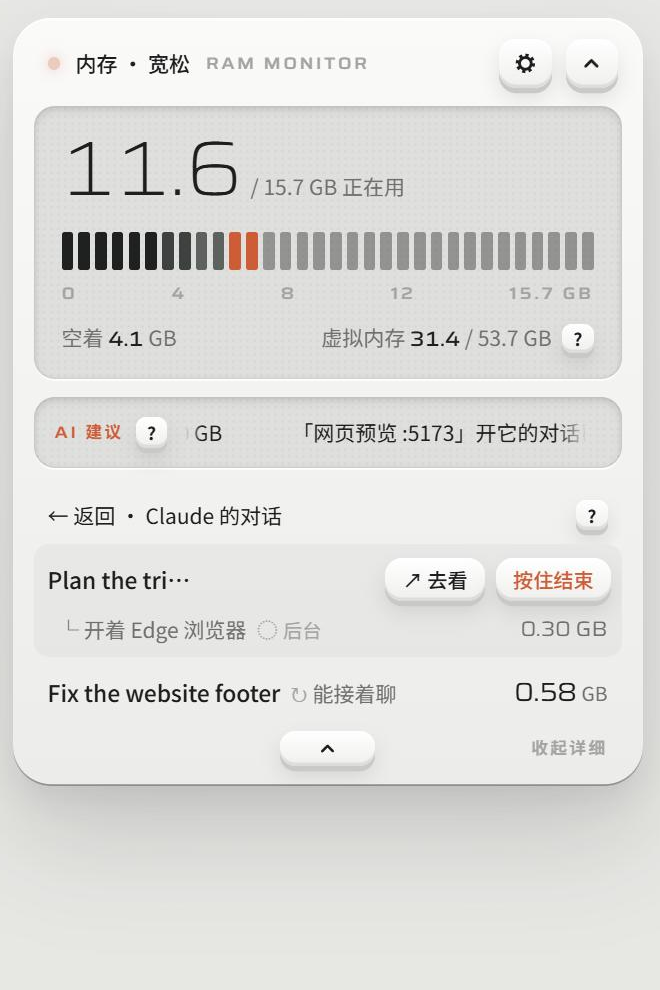

# 内存喵 RAMiao

**一个 Windows 上的小小内存挂件：它知道哪个 AI 对话开了什么。**
Claude Code、Codex、Gemini CLI 这些 AI 干活时，会开浏览器、网页预览、各种小帮手，很多在对话停了以后还一直开着。内存喵待在屏幕顶上，把每个程序挂到开它的那个对话下面，把没人管的挑出来，按住就能结束。

[English](README.md) · [下载 Windows 版](https://github.com/Miaomiaomeowmeow/ramiao/releases/latest)

> **作者正在找工作！** 有机会的话欢迎看看 [我的个人网站](https://miaomiaoyang.com)，或者在 [领英](https://www.linkedin.com/in/miaomiao-yang-331901383) 找我 · 小红书 @羊猫猫不是猫 · [更多](#联系)

| 平时待在屏幕上 | 点开：谁在占内存 | 点进 AI 的 App：一个对话一行 |
|---|---|---|
|  |  |  |

*截图里都是编的示例数据。*

## 它能做什么

- **按对话排，跟你想的一样。** AI 的 App（Claude、Codex……）是一行；点进去，每个对话一行，名字和 App 侧栏里一样，它开的浏览器、网页预览、Blender 就挂在它下面。
- **对话停了，也认得出是谁开的。** AI 工具会在自己开的程序身上留一个小标记，内存喵只看这些标记的名字。所以昨天关掉的对话留下的网页预览，也会写着“「修网站的页脚」开的，对话已经停了”。
- **没人管的放最前。** 主人已经不在的网页预览、用完没关的小帮手，橙色排在最上面。鼠标放到那一行上，按住「按住结束」。
- **↗ 去看**：跳到 Claude App 或 Codex 里的那个对话、把窗口叫到前面、或者用浏览器打开网页预览。
- **用符号，不堆字**：↻ 结束后还能接着聊 · ⊘ 这里只能关它开的东西 · ◌ 在后台跑、没有窗口。前 5 次打开时符号旁边带着字；**?** 里写着每个符号的意思，还有关掉每种东西会怎样。
- **看门员。** 内存真的快没了（不到 1 GB），它会停掉 **AI 开的**、涨得最快的那个，免得电脑卡死。你自己开的程序永远不替你停。也可以改成“只提醒”。
- **问 AI（可选）。** 借你电脑上已经登录好的 Codex 或 Claude Code（不用 Key），或者用你自己的 API Key（Claude 或任何 OpenAI 兼容的服务）。只发程序名和占多少内存，而且只在你点「问 AI」时才发。AI 只出主意，动手的是内存喵，还要你按住确认。
- 中文 / English，白色和石墨两种外观，平时可以是短的小方块或长条。

## 安装

1. 到 [Releases](https://github.com/Miaomiaomeowmeow/ramiao/releases/latest) 下载 `RAMiao_x.y.z_x64-setup.exe`，双击安装。
2. Windows 可能提示“Windows 已保护你的电脑”，因为安装包没有做数字签名（签名要花钱）。点 **更多信息 → 仍要运行**。
3. 屏幕顶上会出现一个写着百分比的小方块，可以拖到任何地方。`Ctrl + Shift + M` 打开 / 收起面板；右下角托盘图标可以藏起来或退出。

支持 Windows 10 / 11（64 位）。Mac 和 Linux 暂时不支持。

完整的中文使用说明：[docs/GUIDE.zh.md](docs/GUIDE.zh.md)

## 认得出哪些 AI 工具

内置：**Claude Code**（Claude App 和终端）、**Codex**（Codex App 和命令行）、Gemini CLI、Cursor、OpenCode、Copilot CLI、Augment、Antigravity、aider。以后出的新工具，只要按通用约定贴了 `AI_AGENT=<工具名>` 标记，也会自动认出来。

### 自己加一个

一个工具的全部信息就是 [`src-tauri/agents.json`](src-tauri/agents.json) 里的一行。照同样的格式写一份，放到 `%APPDATA%\com.miaomiao.ramiao\agents.json`，重开内存喵就行；`id` 一样的会换掉内置那一行。各个字段的意思见 [英文 README](README.md#add-one-yourself)。

## 隐私

- 内存喵从别的程序身上**只读 `agents.json` 里写过的那几个标记名**，别的一概不看。
- 你不选 AI、不点「问 AI」，什么都不会发出去；点了也只发程序名和占多少内存，不发文件、不发窗口标题。
- API Key 只存在这台电脑的内存喵里，只发给你选的那家服务商。

## 从源代码编译

需要 [Node.js](https://nodejs.org)、[Rust](https://rustup.rs) 和 Tauri 2 在 Windows 上要装的东西。

```bash
npm install
npx tauri build
```

安装包在 `src-tauri/target/release/bundle/nsis/`。

## 还没做

- Mac 和 Linux 版（「↗ 去看」叫出窗口目前只做了 Windows）。
- 安装包没有做数字签名。

## 许可

[CC BY-NC-SA 4.0](LICENSE)：可以用、可以改；改过的版本要署原作者、用同样的许可公开；不能商用。用它做了什么，很希望告诉我一声。

## 联系

作者 **Miaomiao**（[GitHub @Miaomiaomeowmeow](https://github.com/Miaomiaomeowmeow)）
个人网站 [miaomiaoyang.com](https://miaomiaoyang.com) · [领英](https://www.linkedin.com/in/miaomiao-yang-331901383) · 小红书 @羊猫猫不是猫
